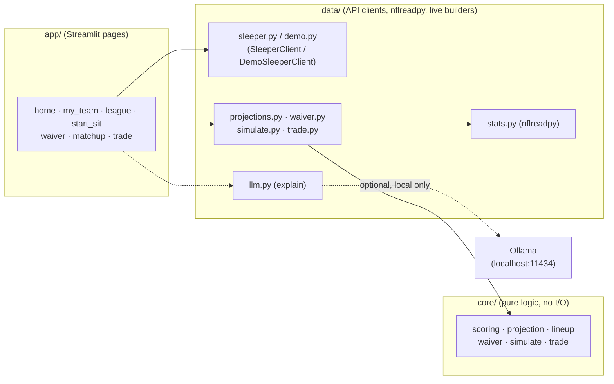

# fantasy-edge

A free fantasy football assistant for Sleeper leagues. Enter a Sleeper
username, pick a league, and get start/sit calls, an optimized lineup,
waiver targets, a matchup win probability, and trade checks.

Every projection and recommendation is computed by transparent, testable
code — never invented by an AI. See [`docs/ROADMAP.md`](docs/ROADMAP.md) for
the full project plan and ground rules.

No Sleeper account? Run the app locally and click "Try the demo instead" —
see [Demo mode](#demo-mode) below.

## Stack

Python 3.12, `httpx`, `pandas`, `nflreadpy`, `polars`, Streamlit, a
file-based cache, `pytest`. Optionally `ollama` (local, free) for AI-polished
explanations — see [Optional AI explanations](#optional-ai-explanations).

## Architecture



`core/` has zero I/O and is the most heavily tested layer (one test file per
module). `data/` combines `core/`'s math with real data from Sleeper and
nflreadpy; `data/demo.py` and `data/stats.py`'s `demo=True` path swap in a
bundled, frozen snapshot instead, so every builder function works
identically either way. `app/` stays thin — each page fetches data, calls a
`data/` builder, and renders a verdict-first UI.

## Setup

```bash
python3.12 -m venv .venv
source .venv/bin/activate
pip install -r requirements.txt
```

## Recording API fixtures

Tests run fully offline against saved fixtures. To (re-)record them from the
live Sleeper API:

```bash
python scripts/record_fixtures.py
```

## Running tests

```bash
pytest
```

## Running the app

```bash
streamlit run app/main.py
```

Enter a Sleeper username on the Home page to connect a league (or click
"Try the demo instead" — see [Demo mode](#demo-mode)), then use the My Team
/ League / Start/Sit / Waiver Wire / Matchup Simulator / Trade Analyzer
pages. Start/Sit shows a live-projected optimal lineup (with a Safe↔Upside
risk slider), a verdict box of recommended swaps, and a side-by-side player
compare with full projection breakdowns. Waiver Wire ranks real free agents
by a rest-of-season projection, your team's positional need, and Sleeper
trending adds, with a suggested drop and (for FAAB leagues) a bid-percent
range. Matchup Simulator runs a 10,000-run Monte Carlo on this week's real
matchup for a win probability, score range, and which players swing it
most. Trade Analyzer compares rest-of-season value *and* each side's actual
starting-lineup impact, with an accept/decline/counter verdict. Works on
mobile browsers too (tested against an emulated iPhone viewport).

## Demo mode

Click **"Try the demo instead"** on the Home page (or open the app with
`?demo=1`) to browse a real, frozen sample league — every page works with
realistic, non-zero numbers and makes zero network calls, so it loads
instantly and needs no Sleeper account. It's a snapshot of one already-
scored week, bundled in `data/demo_data/` (Sleeper JSON) and
`data/demo_data/stats/*.parquet` (the matching nflreadpy stats slice).
Refresh the snapshot against a newer completed week with:

```bash
python scripts/build_demo_data.py
```

## Optional AI explanations

Every verdict (Start/Sit, Waiver Wire, Matchup Simulator, Trade Analyzer) is
a plain template sentence built entirely from already-computed numbers —
the app is fully functional with no LLM at all. Set `LLM_PROVIDER=ollama`
to have a local [Ollama](https://ollama.com) model rephrase that sentence
into friendlier prose. The model only ever sees the already-computed
sentence and is instructed never to add a number or player beyond what's
given (see `data/llm.py`); if Ollama isn't running, times out, or errors in
any way, the app silently falls back to the original template — nothing
breaks.

```bash
ollama pull llama3.2
ollama serve
```

```bash
# .env
LLM_PROVIDER=ollama
OLLAMA_MODEL=llama3.2:latest   # match the tag `ollama list` shows you
```

## Configuration

All optional, read in `data/config.py`. Copy
[`.env.example`](.env.example) to `.env` to set any of these locally; a real
deployment (CI, Streamlit Cloud) sets env vars natively instead.

| Variable | Default | Purpose |
|---|---|---|
| `LLM_PROVIDER` | unset | Set to `ollama` to enable AI-polished verdicts. |
| `OLLAMA_HOST` | `http://localhost:11434` | Where to reach Ollama. |
| `OLLAMA_MODEL` | `llama3.2` | Model tag to use. |
| `OLLAMA_TIMEOUT_SECONDS` | `8` | Falls back to the template past this. |
| `DEMO_MODE` | unset | Boot every new session straight into demo mode. |
| `SLEEPER_CACHE_DIR` | `.cache` | Where the `/players/nfl` cache lives. |

## Deploying to Streamlit Community Cloud

No secrets required — Sleeper is keyless, and Ollama is local-only (leave
`LLM_PROVIDER` unset on Cloud; it has nothing to connect to there, so
explanations just use the template sentences). To deploy:

1. Push this repo to GitHub.
2. On [share.streamlit.io](https://share.streamlit.io), point a new app at
   this repo with entrypoint `app/main.py`.
3. (Optional) set `DEMO_MODE=1` in the app's secrets if you want a
   dedicated, friends-only link that boots straight into the sample league.
4. Share the link. First real (non-demo) page load after a cold start
   triggers a live `nflreadpy` data download, so expect a few seconds'
   delay there — the demo is instant since it skips that entirely.

Live link: *(add after deploying)*

## Projection model backtest

`core/projection.py`'s `project_player` combines four independently-tested
pieces: `baseline_points` (a recency-weighted average of recent fantasy
points), `opportunity_adjustment` (snap %/target share/carry share trend —
opportunity predicts better than raw points), `matchup_adjustment` (the
opponent's fantasy points allowed to that position vs. league average,
shrunk toward average early in the season when there's little data to
trust), and `availability_multiplier` (zero on a bye or when Out/IR,
discounted when Questionable/Doubtful). `core/backtest.py` replays past
weeks using only data available before each week, and reports mean
absolute error (MAE) by position against two naive baselines. Reproduce
with:

```bash
python scripts/run_backtest.py
```

Real results against the connected league's 2026 season, weeks 2-7 (84-312
data points per position; see `scripts/run_backtest.py` for methodology —
players need a full, gap-free game log through the last completed week to
be included):

| Position | Model MAE | Season-avg baseline MAE | Last-week baseline MAE |
|---|---|---|---|
| QB | 6.94 | 6.87 | 7.69 |
| RB | 6.18 | 5.75 | 6.83 |
| TE | 5.93 | 5.79 | 6.02 |
| WR | 5.23 | 4.73 | 5.73 |

The model clearly beats the naive "last week's score" baseline at every
position, but is slightly behind the "season average" baseline this early
in the season (only 1-6 prior weeks of data to compute opportunity trends
and matchup shrinkage from). **What I'd improve next:** revisit this once
more weeks of 2026 data accumulate — the opportunity/matchup adjustments
need a larger sample to add real signal rather than noise on top of the
baseline. Red-zone touches and K/DEF scoring are also out of scope for this
pass (see `data/stats.py`'s module docstring).

## Trade Analyzer value model

The Trade Analyzer's rest-of-season value (`core/waiver.py`'s `ros_value`,
shared with Waiver Wire) builds on the same per-game baseline above, plus:
TD/efficiency regression against nflverse's own expected-points model,
strength of the real remaining schedule, a positional aging-curve
discount, injury/bye handling, and playoff-week weighting — and now:

- **WOPR** (Weighted Opportunity Rating, `1.5×target_share + 0.7×air_yards_share`)
  drives the WR/TE opportunity trend instead of raw target share — a
  validated nflverse volume composite that's already computed in the same
  stats table this app already loads.
- **VORP** (Value Over Replacement Player): each traded player's value is
  also shown relative to a replacement-level baseline at their own
  position, computed from the connected league's actual roster
  construction (team count, starter slots, FLEX/SUPER_FLEX eligibility) —
  the classic value-based-drafting concept, so a QB means something
  different in a superflex league than a single-QB one.
- **Vegas game script**: a small, points-per-game nudge from the real
  spread/total of each remaining game. Coefficients are **empirically
  calibrated**, not hand-picked — `scripts/calibrate_game_script.py`
  regresses each skill player's weekly PPR-points deviation from their own
  season average against real historical spread/total lines across the
  2021-2025 seasons (1,359 games; 3,079-11,926 player-weeks per position):

  | Position | Spread slope (RB-only) | Total slope | Correlation (spread / total) |
  |---|---|---|---|
  | QB | — | +0.0364 | — / 0.023 |
  | RB | +0.0423 | 0.0 (noise) | 0.047 / -0.002 |
  | WR | — | +0.0204 | — / 0.016 |
  | TE | — | +0.0228 | — / 0.021 |

  This matches the research direction (favorites run more; a higher total
  means more scoring opportunity for the passing game) — and confirms total
  doesn't meaningfully move RB production the way it does the passing
  game, so that coefficient is zeroed out rather than kept as noise. These
  correlations are intentionally small: this is a secondary nudge, not a
  primary signal.
- **Trade-deadline awareness**: the Trade Analyzer surfaces the league's
  real trade deadline and warns if it's already passed.

## Screenshots

*(TODO: add screenshots/GIF of the My Team, Start/Sit, and Matchup Simulator
pages — see `docs/screenshots/`.)*

## Status

- [x] Phase 0: Project setup and Sleeper client
- [x] Phase 1: Connect a league
- [x] Phase 2: Projection model and backtest
- [x] Phase 3: Start/sit and lineup optimizer
- [x] Phase 4: Waiver wire
- [x] Phase 5: Matchup simulator and trade analyzer
- [x] Phase 6: Polish and portfolio
